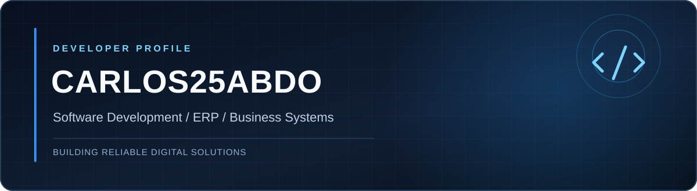

 

### Hi, I'm Serag 👋

**Software Developer · ERP & Business Systems · Web Development**

Building practical software and digital experiences with a focus on reliability, usability, and maintainability.

---

### `> about_me`

I'm based in **Libya** and work on software and web-based solutions, with a particular interest in **ERP systems**, **databases**, and **business workflows**.

- **Focus:** turning complex business requirements into usable systems.
- **Interests:** application architecture, data management, and user-friendly interfaces.
- **Approach:** build, test, document, improve.

### `> tech_stack`

### `> selected_repositories`

These are repositories currently featured on my GitHub profile. Explore each repository for its available source code and documentation.

| Repository | Link |
|:--|:--|
| **my-website** | [View repository](https://github.com/carlos25abdo/my-website) |
| **tamsan-magazine** | [View repository](https://github.com/carlos25abdo/tamsan-magazine) |
| **myc** | [View repository](https://github.com/carlos25abdo/myc) |
| **tocan** | [View repository](https://github.com/carlos25abdo/tocan) |
| **yaser** | [View repository](https://github.com/carlos25abdo/yaser) |
| **tanwir** | [View repository](https://github.com/carlos25abdo/tanwir) |

> **Note:** These are repository names, not claims about functionality or technologies used. Project descriptions can be added after reviewing each repository.

### `> activity`

My public coding activity and contributions are available directly on [my GitHub profile](https://github.com/carlos25abdo). For the full history, see [my repositories](https://github.com/carlos25abdo?tab=repositories).

### `> connect`

I'm interested in exchanging ideas around software development, business systems, and thoughtful digital products.

**[GitHub](https://github.com/carlos25abdo)** · **[All repositories](https://github.com/carlos25abdo?tab=repositories)**

---

  Keep building. Keep learning. Keep improving.

